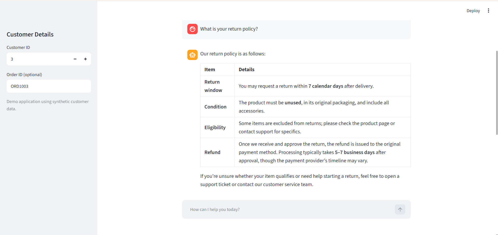
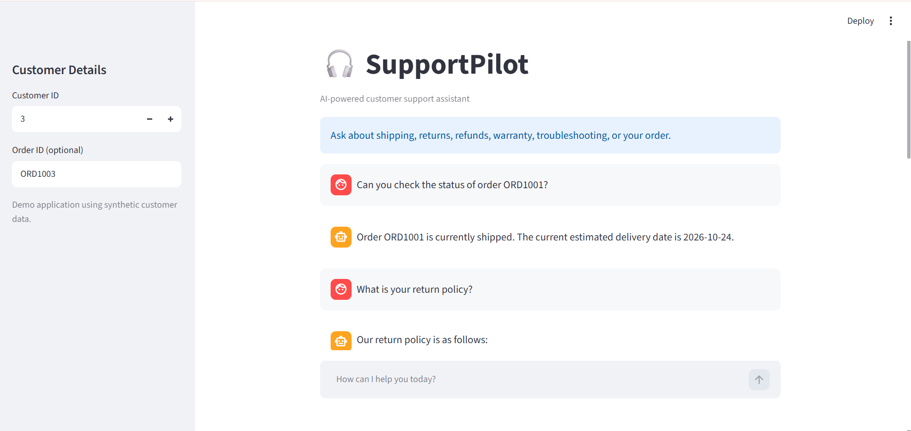
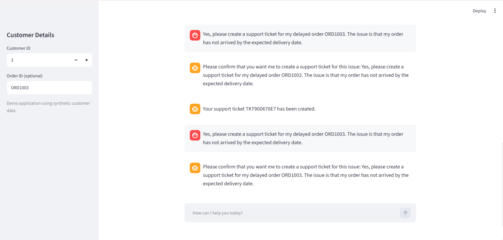
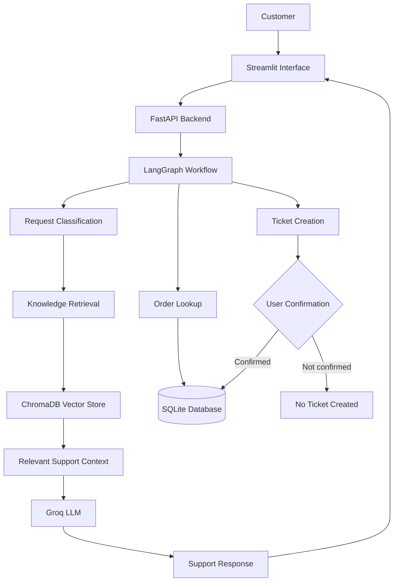

# SupportPilot — AI-Powered Customer Support Automation

SupportPilot is an AI-powered customer support automation system that uses retrieval-augmented generation (RAG) and an agentic workflow to answer customer questions, retrieve relevant support information, look up demo order details, and create support tickets with explicit user confirmation.

The project demonstrates how LLMs, semantic search, APIs, databases, and automated evaluation can work together in a customer support application.

## Features

- **Knowledge-base retrieval:** Uses semantic search to retrieve relevant support documents.
- **AI-powered responses:** Answers questions about shipping, returns, refunds, warranties, and troubleshooting.
- **Request classification:** Routes customer questions into relevant support categories.
- **Order lookup:** Retrieves order information from a demo database.
- **Ticket creation:** Requests explicit user confirmation before creating a support ticket.
- **Evaluation:** Includes a 30-case evaluation dataset and automated tests for application behavior and retrieval.

## Demo Screenshots

### 1. Knowledge Base — Return Policy



### 2. Order Status Lookup



### 3. Support Ticket Creation



## Architecture



_Conceptual architecture of SupportPilot. The diagram summarizes the main components and intended workflow; individual execution paths depend on the implementation._

## Tech Stack

| Technology            | Purpose                               |
| --------------------- | ------------------------------------- |
| Python                | Core application logic                |
| FastAPI               | Backend API                           |
| Streamlit             | User interface                        |
| LangGraph             | Workflow orchestration                |
| Groq API              | Language model inference              |
| ChromaDB              | Vector storage and semantic retrieval |
| Sentence Transformers | Text embeddings                       |
| SQLite                | Demo orders and support tickets       |
| Pytest                | Automated testing                     |

## Getting Started

### Prerequisites

- Python 3.13 or a compatible Python version
- A Groq API key

### Installation

1. Clone the repository and navigate into the project directory.

   ```bash
   git clone <your-github-repository-url>
   cd SupportPilot
   ```

2. Create and activate a virtual environment.

   ```bash
   python -m venv .venv
   ```

   Windows PowerShell:

   ```powershell
   .venv\Scripts\Activate.ps1
   ```

3. Install dependencies.

   ```bash
   pip install -r requirements.txt
   ```

4. Create a `.env` file by copying `.env.example`, then add your own Groq API key. Keep `.env` out of version control.

5. Initialize the demo database.

   ```bash
   python init_db.py
   ```

6. Start the Streamlit interface.

   ```bash
   streamlit run app.py
   ```

Follow any additional backend startup instructions provided by the application if the interface requires the API server to be running separately.

## Running Tests

Run the test suite from the project root:

```bash
python -m pytest -v
```

Run the retrieval evaluation:

```bash
python -m evaluation.evaluate_support
```

Run the answer evaluation:

```bash
python -m evaluation.evaluate_answers
```

The answer evaluator currently uses basic category, source, and keyword checks. The latest recorded result was **26/30 cases passed (86.7%)**. Four abstention cases were flagged for review because the evaluation checks did not recognize the generated wording. This score should not be interpreted as a complete measure of answer quality.

## Project Status

SupportPilot is a portfolio and learning project built with synthetic demo data. It is not intended for production customer support use.

Potential future improvements include:

- More robust answer-quality evaluation
- Improved routing and retrieval relevance
- Authentication and access control
- Production-grade data security and monitoring
- Deployment and integration with real support systems
